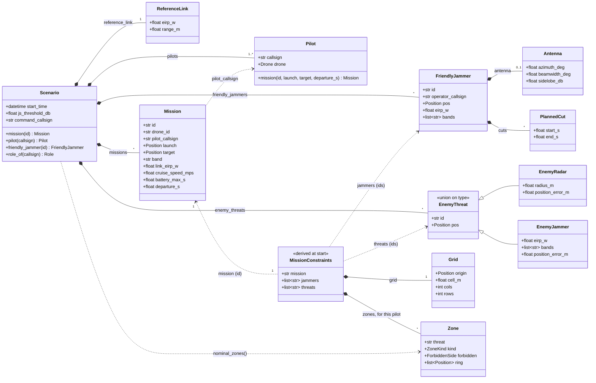
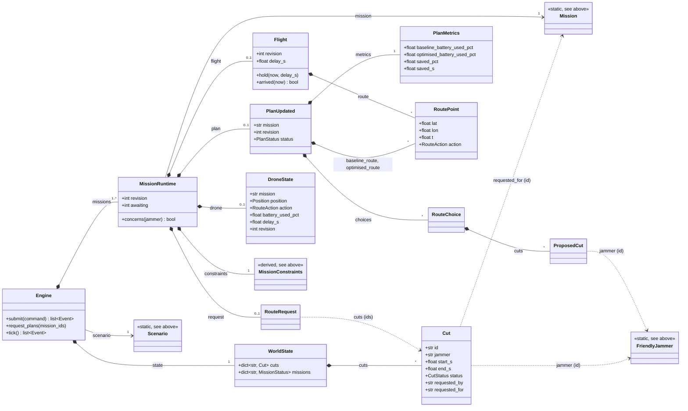

# Corridor architecture

Corridor is a time-aware route planner for drones flying near friendly EW (electronic warfare)
jammers. The jammer schedule is part of the input, so the planner can wait for a scheduled cut
and fly straight through instead of taking a long detour.

```
web front end ◄──WebSocket──► Corridor core ◄──CoT (read + write)──► OTS ◄──► ATAK phones
```

Scope of this document: the application core and the WebSocket interface for the web front end.
The TAK side (CoT, Cursor on Target, through OpenTAKServer to ATAK, the Android Team Awareness
Kit) comes later as one more adapter; the OTS stack in `infra/ots` is ready when needed.

## Principles

- **One owner of state.** The engine holds the world state and the clock and applies the
  safety rules. Nothing else mutates state, so there are no locks.
- **The planner is pure computation.** No state, no asyncio, no clock. Same inputs, same route.
- **Adapters talk to the core through commands and events.** The WebSocket adapter today, the
  TAK adapter later. Adding TAK must not change the core.
- **Lightweight hexagonal.** A port exists only where there are two implementations today.
  No repository (there is no database), no port in front of the planner, no DTO (data transfer
  object) mapping layers, no dependency injection framework.
- **No placeholder code.** A module is created when the code that fills it is written.

## Layout

What exists today:

```
backend/src/corridor/
  domain/
    model.py      pydantic base class shared by every model that crosses a boundary
    geo.py        Position, LocalFrame (lat/lon <-> metres), Grid (cell lookup, covering grid)
    scenario.py   Scenario and its parts, consistency checks, JSON loader
    zones.py      J/S zones (circles of Apollonius, directional beams), radar discs, mission
                  constraints (planning grid, concerned threats), nominal footprints
    terrain.py    elevation file and flight levels: ground per planning grid (cached), profile
                  under a route; flat ground without a file
    zones3d.py    3D jamming zones: J/S per cell and per flight level through the terrain
                  (knife-edge diffraction), loss fields cached per emitter
    heatmap.py    J/S heatmap of a mission on its planning grid, from the planner's own fields
                  and denied cells, rendered as a PNG per level
    state.py      Cut, ClockState, WorldState (runtime state)
    commands.py   domain commands (discriminated union on "type")
    events.py     domain events (discriminated union on "type")
    planner/
      masks.py    zones rasterised on the grid, one numpy mask per interval between cut boundaries
      astar.py    SIPP (safe interval path planning): A* over (cell, level, safe interval)
      layers.py   the masks of each flight level over time, 2D (one layer) or 3D
      plan.py     plan_route() (one set of cuts), plan_mission() (baseline, optimised, metrics),
                  plan_fallback() (from the drone position in flight, no cut)
      smooth.py   string pulling of the grid route on the same masks: fewer points, never in a zone
    safety.py     Flight (route, delay, holds, battery), safety rule, cut start/end transitions
    reasons.py    why a route goes where it goes: the zones that shape it, what it does about each
  engine/
    clock.py      SimClock: accelerated clock with an injectable wall-clock source
    engine.py     Engine: commands, one MissionRuntime per mission (plan, flight, drone),
                  tick (cut transitions, stale plans, flights, safety rule)
    replan.py     ProcessReplanner: mission and fallback plans in a spawned worker process
  adapters/
    ws/
      schemas.py  wire envelopes, Snapshot, Ack, Error
      audience.py who sees what: viewer (callsign, role), scope, event filter, filtered snapshot
      hub.py      fan-out of server messages to connected clients, through the audience filter
      app.py      FastAPI app, /ws endpoint
      server.py   corridor-server entry point
      schema.py   corridor-schema: JSON Schema export
    tak/
      bridge.py   TakBridge: engine events -> CoT through OTS (routes, zones, drones, GeoChat)
  tak/            CoT client and encoders (shapes, markers, GeoChat, delete), corridor-tak CLI
backend/scenarios/demo.json   demo scenario: M1 (J3 between pilot and target, radar to the side, enemy
                              jammer) and M2 12.7 km south with its own jammer J4
backend/scenarios/directional.json   the demo with J3 directional (60° beam to the north, -20 dB sidelobes)
schema/ws.schema.json         generated protocol schema (repository root), consumed by the front end
```

TAK adapter (`adapters/tak/bridge.py`, on with `corridor-server --tak-host`): one OTS
connection; each mission's planned route as a line (remarks: status, times, levels, reasons),
its zones as polygons (deleted when they go away), the drones at most once a second, and the
notifications as GeoChat, direct to a callsign seen on the server, else to All Chat Rooms (the
command's stay in the web front end). Full picture again every 15 s; reconnects every 5 s.
One way: ATAK input does not become commands yet, and the audience rules do not apply to it.

Dependency rule: `domain` imports nothing from `engine` or `adapters`; `engine` imports nothing
from `adapters`. It can be enforced later with `import-linter` if needed.

```
             commands                         commands
 web front ──────────────┐            ┌──────────────── TAK (later: GeoChat "ACK")
 (WebSocket)             ▼            ▼
                    ┌──────────────────────┐
                    │  Engine              │──► planner (pure, runs off the event loop)
                    │  state, clock,       │
                    │  safety rules        │
                    └──────────┬───────────┘
                               │ events
              ┌────────────────┴────────────────┐
              ▼                                 ▼
      WebSocket hub                     CoT adapter (later)
```

## Domain data

Two kinds of data, kept apart:

| | Scenario | World state |
|---|---|---|
| Content | start time, friendly jammers (with optional initial cuts), enemy threats, the pilots and their drone, the missions known at start, the command callsign, the reference link, an optional scripted timeline (`events`) | cuts (scheduled or confirmed), missions requested by pilots, status of each mission; enemy threats and zones to avoid added or removed by the command |
| Source | `backend/scenarios/*.json`, written by hand for the demo | built by the engine from the scenario, then changed by commands |
| Lifetime | static during a run | in memory; restart the server to reset |

- Times are simulated seconds from the scenario `start_time` (for example 14:00:00Z); every
  time field ends in `_s`.
- Scripted timeline (`events`, for a demo told the same way every time): each event fires once,
  at the first tick past its `at_s`, as the command it mirrors: `jammer.restart` (`jammer`, by
  its operator), `threat.add` (same fields as the command, by the command; the engine gives the
  next free id, R2 after R1), `threat.remove` (`threat`), `inject.delay` (`mission`,
  `delay_s`). One that cannot apply (no drone in flight to hold, jammer not cut) is skipped and
  the command is told. `scenarios/hongkong_scripted.json`: Hong Kong with a planned harbour cut
  (14:15 to 14:21, the command confirms it) and the jammer back on at 14:16:40, while the drone
  crosses: it gets out by the nearest way, then flies the safe route.
- Jammers are described by their EIRP (effective isotropic radiated power); the zone they deny
  comes from the J/S (jammer to signal) model below. Radars are discs (`radius_m`).
- A zone to avoid (`type: "avoid"`, `radius_m`) sits with the enemy threats: reported activity
  with no located emitter. It is shown and counts as a concerned threat, but the planner may
  cross it for now (`forbidden_shapes` leaves it out); a high cost instead of nothing is to do.
- **Terrain** (`terrain`, optional). `dem`: a GeoTIFF elevation file in metres above sea level,
  in `backend/data/` (Copernicus GLO-30 crops, a surface model: roofs and trees included, about
  30 m resolution); a name leading out of that folder is refused, and checked at load (scenario
  files themselves are only read from `backend/scenarios/`). Without it the ground is flat at
  0 m. `levels_m`: flight levels above the ground, lowest first (default 30 / 60 / 120 / 250 m,
  the proposal of open decision 39). Each process reads the file once; the ground of a mission
  grid is cached by file and grid, so a threat that changes the grid gets its ground computed
  again on first use.
- **Two grounds per cell** (`ground_cells`), from the file's own pixels (no interpolation) every
  10 m across the cell. A river reads at the bottom of its bed and roofs and trees stand above
  the ground, so one value per cell is wrong one way or the other:
  - `high`, for clearance: highest ground in the cell and its 8 neighbours. Flight levels are
    measured from it: a drone at 30 m is 30 m above banks, bridges, roofs and trees within a
    cell around it. On the demo it is a median 8 m above the cell centre, up to about 60 m.
  - `low`, for terrain masking: lowest ground in the cell. A hill or building hiding the drone
    from an emitter is never taken higher than it is, so no shadow is assumed where there is
    none (jamming zones, pilot link, radars).
- **Buildings** (`terrain.buildings`, optional, needs `dem`): OpenStreetMap footprints with
  `height_m` (the `height` tag, else `building:levels` x 3 m, else 10 m), downloaded once per
  demo area with `uv run python tools/fetch_buildings.py <name> S W N E` into
  `backend/data/buildings_<name>.geojson`. Raised into the elevation: every pixel a footprint
  touches becomes ground + height (ground: lowest elevation within 5 pixels of its centre, so a
  roof on a slope may come out a little low). Planner, 3D zones, profile and RF endpoints all
  see them. `GET /api/buildings` serves the file for the map (empty collection without).
  The Copernicus water body mask is not used (not in `backend/data/`); the rule above covers
  rivers narrower than about two cells. The RF endpoints (`/api/rf/*`) use the same file instead of guessing one
  from the latitude. `mode`: `2d` (default, one layer, free-space discs) or `3d` (the levels,
  zones through the terrain, climbs); `scenarios/demo3d.json` is the demo in 3D.
- A friendly jammer may have a directional `antenna` (`azimuth_deg` clockwise from north,
  `beamwidth_deg` up to 180, `sidelobe_db` up to 0). Its `eirp_w` is then the main beam EIRP.
  Without `antenna` it is omnidirectional. Enemy jammers are omnidirectional for now.
- Friendly jammers are on except during cuts. `cuts` in the file are cuts already scheduled at
  start: they begin as `scheduled` and still need the command's confirmation. Other cuts are
  created live with `cut.schedule`.
- Band filter: a jammer (friendly or enemy) only blocks a mission if its `bands` contain the
  mission `band`. A radar blocks every band.
- **Enemy position error.** Enemy positions are estimates: `position_error_m` (default 0) is
  the radius of the uncertainty on `pos`. The zone covers the zone of every position that
  close, so the route stays clear wherever the threat really is. A radar disc grows by the
  error e. A J/S disc grows by e × k / |k - 1| (exact on the side away from the pilot, a little
  generous on the pilot side); a k < 1 bubble shrinks by as much, and server start fails if
  nothing is left. Nominal footprints are centred on the threat, so they grow by e.
- Several missions share the jammers, threats and cuts. A mission carries the drone, the pilot
  callsign (the pilot stands at the launch point), speed, battery and earliest departure.
- **Pilots and missions.** `pilots` lists each pilot callsign with its drone (`id`, `band`,
  `link_eirp_w`, `cruise_speed_mps`, `battery_max_s`). A pilot may fly several missions. Most
  missions are created at runtime by the pilot (`mission.request`: launch, target, departure);
  `missions` in the file only holds those known at start, possibly none. A file mission names
  its pilot and leaves out the drone fields, which are copied from the pilot's drone (they may
  be given, but must then match it). Engine-side, `Engine.scenario.missions` holds both kinds.
- Zones depend on the pilot (position and link power), so each mission has its own: the same J3
  denies a different area to two missions.
- **Concerned threats and grid** (`mission_constraints`). The grid is not in the file. The
  server starts from launch and target with 3000 m of margin (`--cell-m`, default 100 m). A
  threat concerns the mission when its zone, for this pilot, touches the grid; the grid then
  grows to cover the concerned threats too, until the set stops changing. A cut only replans
  the missions its jammer concerns, and a pilot only sees those threats. Zones may reach past
  the grid; cells outside it are unreachable.
- **Nominal footprint** (`nominal_zones`), for the command view, which sees no particular
  mission: the zone where a drone `reference_link.range_m` from its pilot loses a link of
  `reference_link.eirp_w`, that is a disc of radius `range_m × sqrt(Pj / (t × Ps))` centred on
  the jammer (two radii for a directional one, main beam and sidelobes). Radars keep their disc.
- **Roles.** Every callsign has one: `command_callsign` (sees everything), a pilot `callsign`,
  or a jammer `operator_callsign` (an operator may run several jammers).
- The scenario is checked on load: unique ids, drones and callsigns, at least one pilot, each
  mission flown by a known pilot with its drone,
  non-overlapping initial cuts, known threat `type`, no unknown field. Zones are computed at
  server start, which fails on a degenerate case (jammer on the launch point, or a boundary
  that is nearly a straight line).

Scenario file:

```json
{
  "start_time": "2026-11-21T14:00:00Z",
  "js_threshold_db": 0,
  "reference_link": { "eirp_w": 10, "range_m": 5000 },
  "command_callsign": "CMD",
  "terrain": { "dem": "copernicus_munich.tif", "levels_m": [30, 60, 120, 250] },
  "friendly_jammers": [
    { "id": "J3", "operator_callsign": "EW-J3", "pos": { "lat": 48.145, "lon": 11.567 },
      "eirp_w": 2, "bands": ["2.4GHz", "5.8GHz"],
      "cuts": [ { "start_s": 900, "end_s": 1260 } ] }
  ],
  "enemy_threats": [
    { "type": "radar", "id": "R1", "pos": { "lat": 48.174, "lon": 11.574 }, "radius_m": 2000 },
    { "type": "jammer", "id": "E1", "pos": { "lat": 48.111, "lon": 11.554 }, "eirp_w": 1,
      "bands": ["2.4GHz"] }
  ],
  "pilots": [
    { "callsign": "PILOT-1",
      "drone": { "id": "UAV-1", "band": "2.4GHz", "link_eirp_w": 10, "cruise_speed_mps": 15,
                 "battery_max_s": 1800 } }
  ],
  "missions": [
    { "id": "M1", "pilot_callsign": "PILOT-1",
      "launch": { "lat": 48.145, "lon": 11.513 }, "target": { "lat": 48.145, "lon": 11.621 },
      "departure_s": 600 }
  ]
}
```
- The JSON file is the initial data set, not a storage: nothing is written back. If persistence
  comes, `WorldState` is the one place to plug it.

## Class diagram

Main classes, without the WebSocket adapter (message fan-out and who sees what are documented
under "WebSocket protocol"). Conventions:

- Solid line with a diamond: the class owns the other (composition).
- Dashed arrow: a reference by id (a `str` field), resolved through `Scenario`; the models do not
  hold pointers to each other, so they serialise as they are.
- `Position` (`lat`, `lon`) and the literal types (`Role`, `CutStatus`, `MissionStatus`,
  `PlanStatus`, `RouteAction`, `ZoneKind`, `ForbiddenSide`) are left out.
- Optional fields: `antenna`, `requested_for`, and a mission's `plan`, `flight`, `drone`.

**Static data** (the scenario file) **and what the server derives from it at start.** A
`MissionConstraints` exists per mission: zones depend on the pilot, so the same jammer has one
zone per mission. `nominal_zones()` gives the command view one footprint per threat.



**Runtime state, owned by the engine.** A `PlannedCut` of the scenario file becomes a `Cut` in
`WorldState` at start, `scheduled`. Cuts are shared: one cut of J3 serves every mission J3
concerns. Everything else is per mission, in `MissionRuntime`.



## Ports

| Port | Direction | Implementations |
|---|---|---|
| `Engine.submit(command)` | in | WebSocket adapter |
| `Engine.subscribe(callback)` | out | WebSocket hub; TAK bridge |

The clock is not a port: `SimClock` takes its wall-clock source as a parameter, and tests pass
a fake one.

## Commands and events

Commands and events belong to the domain. Each adapter translates its own wire format:

| | Input -> command | Event -> output |
|---|---|---|
| WebSocket | JSON `cut.confirm` -> `ConfirmCut` | `CutConfirmed` -> JSON |
| TAK (later) | GeoChat "ACK" -> `ConfirmCut` | `CutConfirmed` -> GeoChat, recoloured polygon |

- **Shared vocabulary, not 1 to 1.** The front receives everything; TAK will listen to a subset
  in another shape. Demo controls (`clock.set`) only exist on the front.
- **Every command carries an `actor`**, the sender's callsign. The engine, not the adapter,
  checks it: only the command may confirm a cut, whatever the channel. The web front
  signs in with a callsign (`?callsign=`), which sets its role and what it receives, and may
  only act as that callsign; there is no authentication in the proof of concept.
- **Accepted shortcut on the WebSocket side.** Domain events are pydantic models; the WebSocket
  adapter sends them as they are, inside the envelope. The front is coupled to the domain, which
  is fine for a proof of concept. TAK needs a real translator anyway.

Rules enforced today:

| Command | Rejected when |
|---|---|
| `cut.schedule` | unknown friendly jammer or mission, start in the past, overlap with another cut of the same jammer |
| `cut.confirm` | unknown cut, already confirmed, actor is not the command |
| `route.choose` | unknown mission, not `planned`, no plan yet, actor is not its pilot (the command answers cuts, it does not pick routes), no such choice in the plan, deadline already past, a cut it needs overlaps another cut |
| `route.decide` | unknown mission, actor is not the command, no pending request |
| `cut.cancel` | unknown cut |
| `jammer.restart` | unknown friendly jammer, actor is neither its operator nor the command, the jammer is not cut now |
| `mission.request` | actor is not a pilot |
| `mission.update` | unknown mission, mission not in `planned`, actor is not its pilot |
| `mission.launch` | unknown mission, mission not in `planned`, actor is not its pilot (the command only answers cut requests) |
| `inject.delay` | unknown mission, no drone in flight |
| `threat.add` | actor is not the command; fields not matching the kind (pydantic); a zone the J/S model cannot draw (jammer on a pilot) |
| `threat.remove` | actor is not the command, unknown threat |
| any | `actor` is not the callsign the connection gave (WebSocket adapter) |

## Engine

- `submit` is synchronous and runs on the asyncio event loop thread, so commands never
  interleave and the state needs no lock. Subscribers are called synchronously and must not
  block (the hub only enqueues).
- A rejected command raises `CommandRejected` and leaves the state unchanged.
- Each mission has a `MissionRuntime`: constraints, plan, flight, drone, revision. Revisions
  count per mission.
- Missions: a pilot's `mission.request` builds a mission from its drone, computes its
  constraints on the spot (same grid rules as at startup), adds it to `scenario.missions` and
  requests its first plan. `mission.update` moves the launch and target (and departure) of a
  mission still `planned`: same constraints rebuilt in place, plan dropped, new plan requested
  with the next revision, so a plan still on its way for the old points is dropped.
- Threats: `threat.add` and `threat.remove` (command only) change `scenario.enemy_threats`
  and recompute the constraints of every mission (zones, grid, concerned threats). The missions
  the threat concerns (after an add, before a remove) get a new plan while `planned`. A drone in
  flight keeps its route for now; the command and the pilot are told. Ids are given by the
  server: `R<n>`, `E<n>`, `A<n>`, the first free. Each plan request carries the current
  scenario, so the planner worker always sees the current threats.
- Plans: at startup for every mission, and after every `cut.schedule`, `cut.confirm` or
  `cut.cancel` for the missions the cut's jammer concerns, while they are `planned`, the engine
  requests a plan with the next revision of that mission. The planner only gets the cuts of the
  jammers that concern the mission. The earliest takeoff is the current simulated time plus
  3 wall-clock seconds at the clock factor per plan queued in the same batch (none while
  paused), so the route does not start in the past when it arrives. The tick replans a plan
  whose takeoff time has passed while its mission is still `planned`. A result whose revision
  is not the latest of its mission, or that arrives after launch, is dropped; otherwise it goes
  out as `plan.updated` and is kept for the snapshot. No route at all gives a notification to
  the pilot.
- Cancelling a cut notifies the pilot of every mission its jammer concerns that has not arrived:
  several drones may rely on one cut. A flying drone that needed it falls back (safety rule).
- Without a replanner (`create_app(..., replanner=None)`, used by tests), nothing is planned.
- `tick()` runs every 0.5 s of wall-clock time (app lifespan). It reports confirmed cuts
  starting and ending (a notification to the operator, `jammer.restarted` at the end), replans a
  stale plan before launch, and moves each simulated drone (`drone.state`).
- Launch needs a flyable plan (`approved` or `baseline`), not `preview`: operator confirmation is
  a pre-flight step. Launching after the planned takeoff starts the flight late by the difference.
  Without a replanner, launch needs no plan and nothing flies.
- Flight (`domain/safety.py`): the drone follows the timed route `delay_s` behind it. While held
  (`inject.delay`) it stays where it is; held time in the air counts on the battery.
- Safety rule, every tick: the rest of the route, shifted by the delay, may only be in a friendly
  jammer zone inside a confirmed cut, with the planner margins (2 s of tolerance for sampling).
  It may not enter an enemy jammer or radar zone either, nor in 3D a cell out of the pilot's reach
  (`route_threat`): a threat the command adds while the drone flies. Otherwise (drone late, cut
  cancelled, new threat on the route) the engine requests a `fallback` plan from the drone
  position (`plan_fallback`: no cut, take off now) and switches the flight to it. A drone the new
  zone already covers first flies straight to the nearest cell free at its level
  (`escape_cell`), then the search starts there; the safety rules ignore that escape leg
  (`Flight.escape_until_s`). It is also what happens when a jammer comes back on over the drone
  (`jammer.restart`). A threat away from the rest of the route changes nothing in flight. The pilot gets a notification at each step. No safe route: the
  drone keeps its route and the pilot is told.

## Planner

**Explicit assumptions.** `plan(mission, start=(cell, t), assumptions)`, where the assumptions
say which cuts are taken into account. One function covers every case:

| Case | Start | Assumptions |
|---|---|---|
| Baseline route | launch point, departure time | no cut, every jammer on |
| Optimised route | launch point, departure time | confirmed cuts (`approved`), or scheduled ones too (`preview`) |
| Fallback (drone late, new enemy threat) | current cell and time | no cut (`fallback`) |

**3D planning** (`terrain.mode: "3d"`, `domain/planner/layers.py`). One layer of time masks per
flight level. A cell is forbidden at a level by a jammer's 3D zone widened by one cell (zones are
evaluated at cell centres), an enemy jammer's zone widened further by its 2D position margin
e * k / |k - 1| in whole cells, a radar's 2D disc (every level), or the pilot's minimum signal:
where the control link from the pilot falls below `link_min_dbm` (per drone, default -100 dBm,
open decision 41), widened by one cell (`link_cells`). Zones to avoid stay out;
friendly zones are off during their shrunk cut windows. SIPP then also moves one level up or
down in place, at 3 m/s (`CLIMB_MPS`, open decision 39; climbing costs its flight time). The
search starts at the lowest level (the drone's level for a fallback) and ends over the target
at any level: near it the lowest level may be jammed, and the last descent is the pilot's.
Route points carry `alt_m` (0 on the ground). Smoothing pulls lines within one level; a climb
or descent stays as planned, like a hold. In flight, the safety rule checks the zones at the
drone's level (both levels during a climb). On the Munich demo: detour 686 s with climbs to
120 m (646 s in 2D), J3 cut 629 s; a plan takes about 1 to 2 s against 0.1 to 0.5 s in 2D,
within the 3 s replan allowance. Hong Kong (`scenarios/hongkong.json`, 3D with 31 395 OSM
buildings): pilot on the Tsim Sha Tsui waterfront, target in Quarry Bay, friendly jammer (2 W)
on the harbour crossing, enemy jammer (1 W) on Victoria Peak. Detour 432 s climbing to 250 m
(up to 560 m above sea level over the towers), 308 s through the harbour cut: 29 % saved, where
2D gives 7 %. A pilot standing among the towers (inland Tsim Sha Tsui) gets no route at all: the
city shadows a 2 m antenna. With the pilot's minimum signal at -100 dBm, Victoria Peak puts
40 % (250 m) to 67 % (30 m) of the Hong Kong grid out of the pilot's reach, about 0.2 % of
Munich's at 30 m. Neither demo route changes: near a jammer, a weak link already fails the J/S
test. The threshold matters where there is no jammer: a valley or a street behind a tower
block. Not yet: radars masked by terrain, a vertical speed or battery cost of its own for
climbing.

**Search: SIPP (safe interval path planning)** (`domain/planner/astar.py`).
- Grid of 100 m cells, one altitude layer, 8 neighbours at cruise speed (a diagonal takes
  sqrt(2) times as long as a straight move).
- A safe interval of a cell is a maximal stretch of time during which it is free. A search state
  is (cell, safe interval) and its cost is the earliest arrival in it. From a state the drone may
  leave at any time before the interval closes, hovering until then: waiting for a cut is part of
  the search and needs no time step. With no cut, every free cell has one interval and SIPP is
  plain A* on the grid.
- A move is accepted only if both cells, and for a diagonal the two corner cells, stay free for
  the whole move.
- Heuristic: octile distance at cruise speed, a lower bound on the time left, so the first
  arrival at the goal is the earliest.
- Cost: flight time, hover included, ground wait excluded (energy is proportional to it for a
  multirotor, not for a fixed-wing aircraft that has to loiter).

**Takeoff time** (`domain/planner/plan.py`). Minimising flight time with a free ground wait is
not the same as arriving earliest, so takeoff is a variable of the plan: one SIPP search per
candidate takeoff: first the earliest departure (flight time F0), then every 30 s from
"first window opens - F0" (an earlier takeoff cannot beat F0) to the last takeoff that can still
reach a cut zone before its window closes, then every 5 s around the best one. A better takeoff
narrower than 30 s can be missed. Each search stops once its lower bound passes the best flight
time found so far. A `plan_mission` takes about 0.3 to 1.7 s on the demo. A hover over the launch cell is turned into ground wait. Routes that exceed
`battery_max_s` of flight are rejected.

**Smoothing** (`domain/planner/smooth.py`). The SIPP route moves between cell centres in 8
directions: across open ground it is a staircase. Every route the planner returns (baseline,
approved, preview, fallback) is smoothed on the masks it was searched on:
- From each kept point, jump to the farthest later point reachable in a straight line at cruise
  speed through cells that are free the whole time the drone is in them, corners the line only
  touches included (as SIPP never cuts a forbidden corner). Same masks, so same margins.
- A straight line is never longer than the staircase, so every point is reached no later than
  planned. Holds (hovers waiting for a cut) are never skipped and keep their departure time, so
  the crossing keeps its window.
- If a point would be reached too early (a cut zone not open yet), the drone waits there until
  its planned departure; before the first hold, the take-off is then pushed back to turn that
  wait into ground time. If even that is not clear, the route stays as SIPP planned it.
- Flight times and metrics are those of the smoothed route, so plan comparison uses them too.

**Statuses** (`plan_mission`). Baseline: no cut. Then the best route on confirmed cuts
(`approved` if it saves more than 1 s), then on every cut (`preview` if it saves more than the
approved or baseline one). Otherwise `baseline`. `fallback`: `plan_fallback`, from the drone
position, no cut; its baseline is the route itself (nothing to compare).

**J/S zones** (`domain/zones.py`). In free space, with EIRP taken toward the drone and the jammer
on the link band, the J/S ratio at the drone is

    J/S = (Pj / dj^2) / (Ps / ds^2)

with Pj the jammer EIRP, Ps the pilot link EIRP, dj and ds the distances from the drone to the
jammer and to the pilot. The link is lost where J/S >= t (t = 10^(threshold_db / 10)), that is
where ds / dj >= k with k = sqrt(t Ps / Pj). The boundary is a circle of Apollonius:

- k > 1 (link stronger than jammer, after threshold): a disc around the jammer, pushed away
  from the pilot. Forbidden inside.
- k < 1 (jammer stronger): the jammer wins everywhere but a bubble around the pilot. Forbidden
  outside. With realistic powers (50 W jammer, 1 W link, 0 dB) this is the usual case: no
  detour exists, only waiting for a cut works.

The pilot stands at the launch point, so the zones are fixed for a mission and computed once.
Jammers whose bands do not contain the mission band have no zone. Zones go to the front (and
later to TAK) as rings of 64 points with the forbidden side; neither needs to know the model.
Terrain would change the shapes, not the contract.

**Directional jammers.** A jammer with an `antenna` has two EIRPs: `eirp_w` inside the main
beam (a horizontal sector with a hard edge), `eirp_w × 10^(sidelobe_db / 10)` elsewhere. Its
zone is the main Apollonius disc inside the beam and the sidelobe disc outside it. With k > 1
both discs contain the jammer, so the zone is star-shaped around it and the ring is sampled
from the jammer outward (64 vertices across the beam, the rest on the sidelobe disc). The
`Zone` contract does not change. A directional jammer with k < 1 is rejected at server start:
its zone would be an unbounded wedge that a ring cannot describe. The beam is horizontal only
(the planner is 2D plus time) and its edge is hard, without gain roll-off.

**3D jamming zones** (`domain/zones3d.py`, used by the planner in `3d` mode). For each cell of a
mission grid and each flight level, J/S from each jammer on the mission band:
received power = EIRP toward the cell - free-space loss over the slant distance - diffraction
loss. Diffraction: terrain profile from the emitter to the cell centre, one sample per cell,
Earth bulge (k = 4/3), the most blocking obstacle as a single knife edge (ITU-R P.526), as in
`rf/coverage.py`. Lost where J/S >= `js_threshold_db`. Choices that keep zones on the large side:
the drone at level L flies L above the cell's `high` ground; a jammer path takes its obstacles
from `low`, the pilot link from `centre` (the surface model as is; `high` would block a 2 m
pilot antenna everywhere). Antenna heights are constants for now: jammer 10 m, pilot 2 m. On
flat ground the top level gives the 2D disc. On the Munich demo, J3 denies at 30 m 73 % of M1's
grid with a 2 m pilot antenna and 13 % with a 10 m mast, against the 2D disc (9 %) at 120 m and
above: flying low costs the pilot link. About 0.2 to 0.7 s per mission, then cached (a cut
recomputes nothing; a new threat only its own field). Enemy position margins and masks over
time come with the 3D masks. `link_lost`: where `pilot_signal` is below the mission's
`link_min_dbm`, jammer or not.

**Map layers.** One question each, so the map and the planner cannot disagree:

- Zones: where the tactical objects are. Jammers and radars as points, zones to avoid as
  surfaces. No reach.
- Terrain RF (`rf/coverage.py`, `GET /api/rf/coverage`): simplified reach. Jammers: received
  power contours by polar ray casting, one height (20 m), rays every 10 degrees. Radars: their
  disc, `radius_m + position_error_m`, as the heatmap and the planner see it. Not used by the
  planner.
- Heatmap (`domain/heatmap.py`, `GET /api/heatmap?mission_id=&level=&off=`): the planner's view.
  J/S of the strongest jammer still on, per cell, from `zones3d.jamming_zones` (2D: flat ground at
  the top level, the free-space values of the discs). Denied cells are exactly the planner's:
  `cells_by_threat` in 3D, `shape_mask` of the 2D zones in 2D, so they reach about one cell past
  the J/S threshold. `off` lists the friendly jammers in a cut at the instant shown; the front end
  fetches again only when that set changes. Radars are a separate mask, never mixed into J/S (a
  pilot may cross radars, never a jammer), shown even when the pilot crosses them. In 3D, the
  cells out of the pilot's reach (`link_cells`) are a mask of their own too: the planner forbids
  them whatever the cuts, for a weak link rather than a jammer. Classes against
  `js_threshold_db`: safe, caution (within 6 dB), denied, radar, out of reach. The PNG has 4
  pixels per cell side, J/S interpolated and masks traced with rounded edges.

The traced outlines of the 3D cells (`adapters/ws/outlines.py`, `GET /api/zones3d`) are no
longer drawn: the heatmap replaces them. Still to align: the hover probe (`/api/rf/probe`) runs
its own model at 20 m. A jammer is off on the heatmap for its whole confirmed cut, while the
planner shrinks the cut by its margins: near the start and end of a cut, the map shows a corridor
the planner does not use yet. Radars masked by the terrain (line of sight) are to come in the
planner, the heatmap and Terrain RF together.

**Route reasons** (`domain/reasons.py`, `reasons` on `plan.updated` and on each route choice).
A zone shapes a route when it lies on the straight line from launch to target (at the lowest
level in 3D) or when the route crosses it. For each, in order along the way: `avoided` (around
it), `climbed_over` (3D: the ground track passes under its lowest-level footprint, at a level
it does not reach), `crossed_in_cut` (inside a friendly zone only within a cut of that jammer;
for a choice, its proposed cuts count), or `crossed` (a radar the mission may cross, a zone to
avoid, a jammer crossed anyway), with entry and exit times for crossings. Zones are the
planner's: shapes in 2D, per-level cells in 3D (`LINK` for the cells out of the pilot's reach).
Zones to avoid are not enforced, so they only appear when crossed. The time the detours cost is
in the metrics as a whole, not per zone. The engine computes them when it sends a plan.

**Forbidden cells.** Cuts are piecewise constant in time, so `masks.py` precomputes one mask per
interval between cut boundaries with numpy, not one per time step. A cell is forbidden when it
lies on the forbidden side of:

- a friendly jammer zone, unless the jammer is cut at that moment;
- an enemy jammer zone, at all times, widened by its position error;
- a radar disc (hard ban), widened by its position error.

The test runs on the cell centre with the boundary pushed out by half the cell diagonal, so a
cell is forbidden as soon as any part of it may touch a zone. For a directional jammer, a cell
counts for the main disc if it may touch both that disc and the beam (centre inside, or within
half a diagonal of an edge ray), and for the sidelobe disc if it may touch both that disc and
the outside of the beam. This may forbid a few cells too many, never too few.

**Demo calibration, for the jury.** `backend/scenarios/demo.json` uses a 0 dB threshold, a control link
of 10 W EIRP toward the operating area (for example 1 W behind a 10 dBi ground antenna, assuming
the drone stays in its main beam), a 2 W friendly jammer and a 1 W enemy jammer. J3 then denies
a 2.2 km radius disc centred 1 km beyond it. The radar disc overlaps it, so there is no gap
between them. Two detours remain, and the planner picks the shorter one for the baseline: north
around the radar, or a corridor about 600 m wide in the south, between J3 and E1. The threshold
depends on the link waveform (frequency hopping links tolerate more); 0 dB is a conservative
round figure. With realistic powers (50 W jammer, 1 W link) k < 1 and no detour exists: the
demo deliberately shows the case where a detour is possible, to compare it with waiting for a
cut.

Measured on the demo (departure 600 s, 1800 s of battery), smoothed routes: the baseline takes
the south corridor, 646 s of flight (36 %, 7 points; 681 s and 21 points before smoothing). A
J3 cut from 900 s to 1260 s leaves a 270 s window after the margins, shorter than the 308 s of a
straight crossing: the route crosses J3 off-axis and saves about 9 % (5 points). A cut of 600 s
(900 s to 1500 s) gives a straight crossing and saves about 17 % (3 points).
The cut length is a demo tuning choice.

When no route exists without a cut (the k < 1 case), `plan_mission` returns None for now: the
metrics are defined against a baseline. To decide if the demo needs that case.

**Safety margins live in the masks.** "Enter at least 30 s after the cut starts, leave at least
60 s before the restart" means each cut window shrinks to [start + 30 s, end - 60 s] before the
search runs. The route is safe by construction, not checked afterwards.

**Off the event loop, with revisions.** A plan takes up to about 2 s of pure Python, so it
runs in a `ProcessPoolExecutor` with one worker (a thread would hold the GIL, Python's global
interpreter lock). The worker is spawned, not forked: a forked worker inherits uvicorn's signal
handlers, ignores SIGTERM and outlives the server. Plans of all missions queue on that worker;
a new request cancels a pending one of the same mission that has not started. Each request carries a revision number; a result that comes back after a newer
revision was requested is dropped. The result re-enters the engine on the event loop thread,
then goes out as `plan.updated`.

## Time

- Simulated time is driven by the clock factor (x10 to x30 for the pitch, `--clock-factor`,
  default 20). The clock starts paused at t = 0; the front starts it with `clock.set`.
- The front can render any instant on its own (see below), so scrubbing the timeline never
  touches the server clock.
- For the later CoT adapter: `start` and `stale` must carry wall-clock time. With an accelerated
  clock, simulated times would reach ATAK as future or already stale events. Simulated time goes
  in labels and chat text only.

## WebSocket protocol

Run the server from `backend/` with `uv run corridor-server` (`--scenario`, `--host`, `--port`,
`--clock-factor`). Endpoint: `ws://127.0.0.1:8000/ws?callsign=PILOT-1`.

**Who sees what** (`adapters/ws/audience.py`). The callsign in the URL says who connects and
the scenario gives its role; an unknown or missing callsign is closed with code `4003`. There is
no authentication, but a command whose `actor` is not that callsign is rejected. The filter runs
on the server (need to know: a pilot never receives another mission, even hidden):

| | command | pilot | operator |
|---|---|---|---|
| Missions (plans, drones, status) | all | its own (none before its first request) | those its jammers concern |
| Friendly jammers and their cuts | all | those that concern its missions | its own |
| Enemy threats | all | those that concern its missions | none |
| Pilots (callsign, drone) | all | itself | pilots of the missions in view |
| Nominal zones | all | none (it has its mission zones) | its jammers |
| Notifications | all | to itself | to itself |
| Clock | yes | yes | yes |

Client to server:

```json
{ "req_id": "r1", "command": { "type": "cut.schedule", "actor": "EW-1", "jammer": "J3", "start_s": 900, "end_s": 1260 } }
```

Server to client:

```json
{ "seq": 1, "sim_time_s": 0.0, "payload": { "type": "cut.scheduled", "cut": { } } }
```

- `seq` grows by one per broadcast event, whoever sees it, so a client may see gaps. `snapshot`,
  `ack` and `error` carry the current `seq` without incrementing it.
- A command gets its events (broadcast to every client allowed to see them) first, then its
  `ack` (sender only).
  A rejected command gets only an `error` with its `req_id`; an unparsable message gets an
  `error` with `req_id: null`.
- A reconnect gets a fresh `snapshot`, so no client-side resync logic is needed.
- `mission.created` is followed, for every client that sees the mission, by a fresh `snapshot`:
  the mission may bring jammers, threats and cuts into its view. The client just replaces its
  state, as on connect. `mission.updated` is followed by a fresh `snapshot` for every client:
  the mission may also leave a view (an operator whose jammer it no longer crosses).
  `threat.added` and `threat.removed` work like `mission.created`, for the command and every
  client that sees one of the missions the threat concerns.

**`plan.updated`**

```json
{ "type": "plan.updated", "mission": "M1", "revision": 3, "status": "approved",
  "metrics": { "baseline_battery_used_pct": 85, "optimised_battery_used_pct": 52,
               "saved_pct": 38.8, "saved_s": 594 },
  "baseline_route":  [ { "lat": 48.145, "lon": 11.513, "t": 600, "action": "fly" } ],
  "optimised_route": [ { "lat": 48.145, "lon": 11.513, "t": 600, "action": "ground" },
                       { "lat": 48.145, "lon": 11.513, "t": 840, "action": "fly" } ] }
```

- A route point is the position at time `t`; `action` (`fly`, `hover`, `ground`) holds until
  the next point. Only points where the direction or the action changes are sent; the front
  interpolates. In 3D, `alt_m` is the height above the clearance ground (the highest ground
  within a cell around: what the drone must clear), 0 on the ground, and `amsl_m` the altitude
  above sea level (clearance ground of the point's cell + `alt_m`). Both `null` in 2D.
- A level is a height above the clearance ground, so between two route points the drone
  follows that ground: its altitude is not a straight line between the points. `profile`
  carries it: under the optimised route, every 50 m of flight and at each point, `distance_m`
  from take-off, `lat`, `lon`, `ground_m` (ground surface above sea level, 0 without an
  elevation file), `alt_m` and `amsl_m` (`null` in 2D). For the altitude profile and a 3D
  view of the route (a line through the `profile` points at `amsl_m`).
- `status`: `preview` (uses a cut not confirmed yet, not flyable), `approved` (confirmed cuts
  only), `fallback` (drone late, safe route from its position), `baseline` (no usable cut),
  `straight` (cut refused, plan B: the direct route through the jammer still on).
- Battery figures are consumption in % of `battery_max_s`. `saved_pct` is relative to the
  baseline consumption: (85 - 52) / 85 = 38.8 %, not the 33 point difference. `saved_s` counts
  flight time, hover included, ground wait excluded.
- `choices`: the routes the pilot may pick, at most three, in this order:
  `fastest` (cuts every friendly jammer it needs), `one_cut` (the fastest cutting a single
  jammer), `safe` (the flyable route as is, no new cut). Each gives `cuts` (jammer, start, end;
  the window already includes the entry and exit margins, so scheduling it as is gives
  `route`), `route`, `flight_s`, `battery_used_pct`, and `saved_s` / `saved_pct` against
  `safe`. A choice needing cuts appears only if it saves 30 s against the one after it, so
  `fastest` is dropped when it does no better than `one_cut`. Jammers with a cut not over by
  departure are left alone. Computed by `corridor.domain.planner.plan.route_choices`: the
  windows span the time the drone would spend in each zone if those jammers were off for the
  whole flight, then the route is searched again with those windows only.

**Route request.** The pilot picks a choice with `route.choose`. `safe` stands at once
(`status: accepted`). A choice needing cuts schedules them (`requested_for` the mission) and
asks the command with a `route.decide` notification; the request is `pending` until a deadline
2 minutes before the take-off of that route or its first cut, whichever comes first. The
command answers with `route.decide` (accept confirms the cuts and orders the jammer operators,
refuse cancels them). Only the command ever cuts: unanswered at the deadline, the request is
refused (`decided_by: "timeout"`), and launching while still `pending` refuses it
(`decided_by: "launch"`). After a refusal the pilot's plan B, `on_timeout`, decides the flight:
`avoid` flies the `safe` route (the detour), `cross` flies the route picked anyway, straight
through the jammers still on (`RouteRequest.route`, `jammers`): the control link may be lost
there, and the safety rule leaves those jammers alone (`Flight.through_jammers`). At launch the plan
becomes that route, with status `straight`, so every view shows what is flown. Without a
detour (the pilot stands in a jammer zone) the front always sends `avoid`: no answer, no flight. Picking again withdraws a pending request
and its cuts. Every change goes out as `route.request` and is kept for the snapshot.

**Server to client**

| Type | Status | Content |
|---|---|---|
| `snapshot` | done | on connect, filtered for the viewer: viewer (callsign, role), scenario, nominal zones, clock, cuts, and per mission its constraints (grid, zones, concerned jammers and threats), status, latest plan (or null), latest drone state (or null), route request (or null) |
| `clock` | done | sim time, factor, paused; on change only |
| `cut.scheduled`, `cut.confirmed`, `cut.cancelled` | done | the cut (`requested_for`: the mission it was asked for, if any) |
| `mission.created` | done | the full mission (drone fields from the pilot); a new `snapshot` follows, then a notification to the pilot and the first `plan.updated` |
| `mission.updated` | done | the mission with its new points and departure; a new `snapshot` follows for every client (plan back to null until the next `plan.updated`) |
| `threat.added`, `threat.removed` | done | the threat (or its id) and the missions it concerns; a new `snapshot` follows, then notifications to the command and the pilots, then the new `plan.updated` |
| `mission.status` | done | mission id; `planned`, `flying`, `arrived` |
| `notification` | done | `to` (callsign), text, optional action: `cut.confirm` with the cut, or `route.decide` with the mission whose request awaits an answer |
| `route.request` | done | the route request of a mission: kind, cut ids, saving, deadline, `on_timeout`, status (`pending`, `accepted`, `refused`), `decided_by` |
| `ack`, `error` | done | `req_id`, reason on error |
| `plan.updated` | done | see above; after every change to the cuts of a jammer that concerns the mission, while it is `planned`; arrives after the command's `ack` |
| `drone.state` | done | mission id, position, action, battery used, delay, route revision; every tick in flight |
| `jammer.restarted` | done | jammer id and cut id, with a notification to its operator |

**Client to server**

| Type | Status | Payload |
|---|---|---|
| `cut.schedule` | done | jammer, start, end, optional mission it is asked for |
| `cut.cancel` | done | cut id |
| `jammer.restart` | done | friendly jammer id: back on now, before the end of its cut (the cuts covering now are cancelled); its operator or the command; "Back on now" on a running cut |
| `cut.confirm` | done | cut id; command only |
| `mission.request` | done | `launch`, `target`, `departure_s` (a past one means as soon as possible); the mission id is `M<n>`, the first one free |
| `mission.update` | done | mission id, `launch`, `target`, `departure_s`, optional `cross_radars` (routes may fly through radar zones, never jammers; omitted keeps it); only while `planned`; drops the route request and its cuts |
| `route.choose` | done | mission id, `kind` (`fastest`, `one_cut`, `safe`), `on_timeout`: plan B if refused or unanswered (`avoid`: detour, default; `cross`: straight through the jammers anyway); its pilot only |
| `route.decide` | done | mission id, `accept`; command only |
| `mission.launch` | done | mission id; its pilot only |
| `clock.set` | done | factor and/or paused |
| `inject.delay` | done | mission id, `delay_s`: hold the flying drone where it is (demo twist) |
| `threat.add` | done | `kind` (`radar`, `jammer`, `avoid`), `pos`; `radius_m` for a radar or a zone to avoid, `eirp_w` and `bands` for a jammer; optional `position_error_m` (not for a zone to avoid) |
| `threat.remove` | done | threat id (from the file or added) |

**Contract.** `schema/ws.schema.json` is generated from the pydantic models
(from `backend/`: `uv run corridor-schema > ../schema/ws.schema.json`) and a test fails when it is out of date. Its
`client` and `server` properties are the two message types; every `type` field is required, so
the generated TypeScript unions discriminate on it. For example with `json-schema-to-typescript`
(not tried yet: check how it renders `Cell`, a two-integer tuple):

```bash
npx json-schema-to-typescript schema/ws.schema.json > src/corridor-ws.d.ts
```

**Rendering on the front.** Cuts are known in advance and routes are timed, so from the snapshot
and the last `plan.updated` of each mission the front can draw the state at any instant, past
or future. Zones come ready to draw in the snapshot: per mission in `constraints.zones`, and
mission-independent in `nominal_zones`; one ring per threat, filled on its `forbidden` side (for
`outside`, a polygon covering the mission grid with the ring as a hole). A friendly jammer zone is
active unless one of its cuts covers the instant shown.

## Dependencies

Runtime: `fastapi`, `uvicorn`, `websockets` (uvicorn needs it to serve `/ws`), `pydantic`,
`numpy` (planner masks). Dev: `httpx` for the WebSocket test client.

## Open decisions

The defaults below do not change the layout; they live in the planner or in `safety.py`.

| Question | Default |
|---|---|
| Drone speed | per mission (`cruise_speed_mps`) |
| Cell size | 100 m, with masks precomputed per interval; 200 m if replans are too slow |
| Operator confirmation | required before take-off; a confirmation in flight does not reroute |
| "Signed CoT" in the pitch | not true today (plain TCP 8088); TLS on 8089 or drop the claim |
| Longest ground wait before takeoff | unbounded: a cut an hour ahead gives a plan that waits an hour on the ground |
| No route without a cut (k < 1) | `plan_mission` returns None (metrics need a baseline) |
| Preview better than a flyable approved route | `preview` wins the single `optimised_route` slot, the pilot loses the flyable route until confirmation (never happens with one cut) |
| Plan shown while a replan runs | the previous plan stays (in the snapshot too) until the new one arrives, about 1 to 2 s; after a `cut.cancel` it may cross the cancelled cut; if the worker fails it stays, only logged |
| Launch on a `preview` plan | rejected ("the plan relies on a cut not confirmed yet") |
| Battery left for a fallback | `plan_fallback` allows a full `battery_max_s`; the battery already used is not deducted |
| Replan lead time | 3 wall-clock seconds (`PLAN_LEAD_WALL_S`); two queued plans can exceed it |
| Pilot minimum signal (41) | `link_min_dbm` per drone, default -100 dBm (quoted sensitivities of drone control receivers run from about -95 to -110 dBm; to set per drone with the team). 3D only: in 2D free space the range at -100 dBm is far past any grid |
| Directional jammers | hard beam edge, sidelobes required (`sidelobe_db`), friendly jammers only, k < 1 rejected, not used in `demo.json` |
| Route smoothing | greedy string pulling, farthest point first, between the points of the SIPP route only (a better line through the middle of a straight run can be missed); holds kept |
| Planner choices made in step 3 | SIPP and a 30 s / 5 s takeoff sweep, cuts must save more than 1 s, cells forbidden if any part may touch a zone, radar is a hard ban, margins 30 s / 60 s as constants in `plan.py` |
